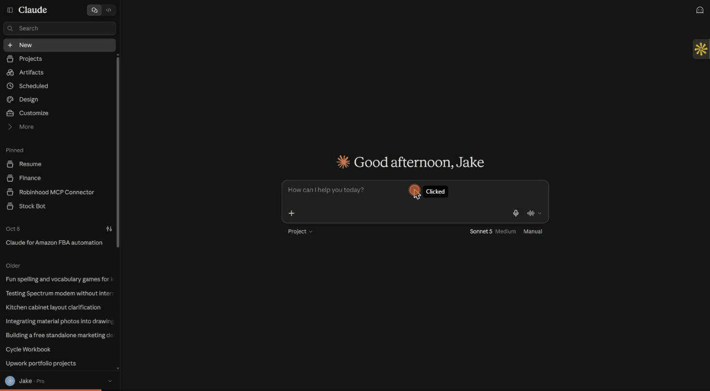
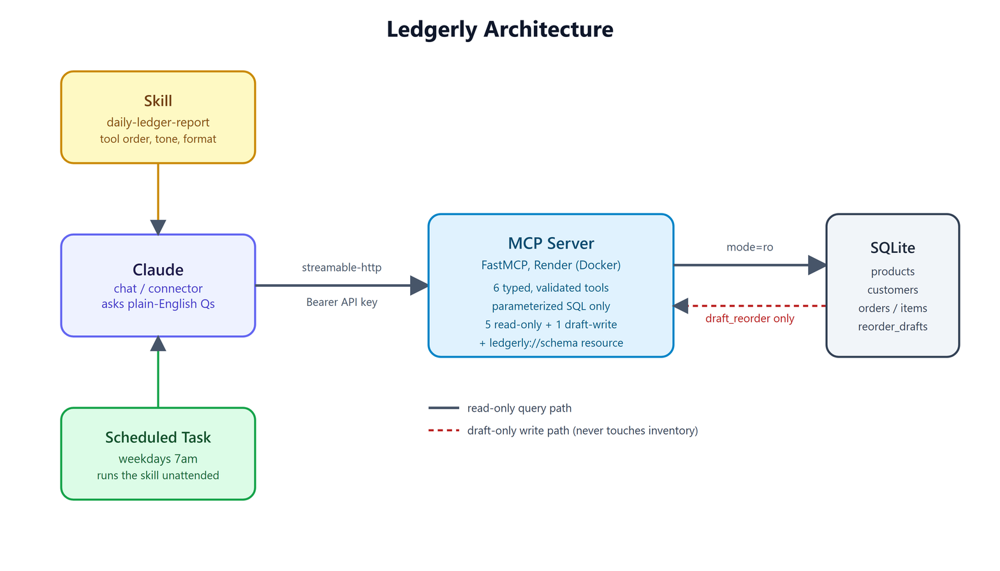

# Ledgerly

**Your business, briefed before breakfast.**
A Claude-connected business data server with automated daily reporting. Built on the Model Context Protocol (MCP).

Ask Claude plain-English questions about a shop's sales, inventory, and customers, and get a short report each morning without opening a dashboard.

> All data is synthetic. A seed script generates six months of fake orders for a demo online shop.



## What it does

| Piece | Purpose |
|---|---|
| **MCP server** (`server/`) | Exposes the shop database to Claude through safe, validated tools |
| **Skill** (`skills/daily-ledger-report/`) | Encodes the morning-report process so output is consistent every day |
| **Scheduled routine** | Runs the skill daily and delivers the report (setup below) |

Example questions Claude can now answer:
- "Why did revenue drop two days ago?"
- "Which products will run out this week?"
- "What has customer 42 bought, and what are they worth?"
- "Draft a reorder for anything under a week of stock."

## Architecture



Claude never touches the database directly. Every request goes through the MCP server's typed, validated tools, which run parameterized SQL against SQLite — read-only for every query tool, with a single narrow write path for draft reorders. The skill encodes the daily-report process on top of those tools, and the scheduled task runs that skill unattended.

## Tools

| Tool | Type | Description |
|---|---|---|
| `get_revenue` | read | Revenue, gross profit, order count grouped by day/week/month/category/product |
| `top_products` | read | Best sellers by revenue for a date range |
| `low_stock` | read | Items below reorder point, with days of stock left |
| `search_orders` | read | Filter orders by status, customer, dates |
| `customer_summary` | read | Lifetime value, first/last order, favorite category |
| `draft_reorder` | draft | Creates a draft purchase-order line. **Never places an order.** |

Resource: `ledgerly://schema` gives Claude the table layout before it queries.

## Security design

- **Claude never writes SQL.** Every tool takes typed arguments and runs parameterized queries.
- **Read-only by construction.** Query tools use a SQLite connection opened with `mode=ro`. Even a bug can't modify business data (covered by a test).
- **Draft-only actions.** The one write path inserts into a `reorder_drafts` table and never touches inventory. A human reviews and places real orders.
- **Input validation.** Dates, enums, and numeric ranges are checked before any query runs (injection attempts are in the test suite).
- **Remote mode requires an API key.** The HTTP transport refuses to start without `LEDGERLY_API_KEY`.

## Quick start

```bash
pip install -r requirements.txt
python data/seed.py          # creates data/shop.db with ~1,700 fake orders
python -m pytest tests -q    # 14 tests
```

### Connect to Claude Code (local)

```bash
claude mcp add ledgerly -- python -m server.server
```

If the `claude` CLI isn't on your PATH (e.g. you're only running the desktop app), a project-scoped [`.mcp.json`](.mcp.json) is already included and picked up automatically — no CLI needed.

Then ask: *"Using ledgerly, give me this week's top products and anything low on stock."*

### Connect to Claude Desktop (local)

Add to `claude_desktop_config.json`:

```json
{
  "mcpServers": {
    "ledgerly": {
      "command": "python",
      "args": ["-m", "server.server"],
      "cwd": "/absolute/path/to/ledgerly"
    }
  }
}
```

### Install the skill

Copy `skills/daily-ledger-report/` into your Claude skills folder (or upload it in Claude's skill settings), then ask for "the daily report".

## Deployment (Render free tier)

A scheduled task can only reach your server if it's online when the task fires, so for scheduled reports you need a real deployment, not `localhost`. `render.yaml` and the `Dockerfile` are both already set up for this.

1. **Push the repo to GitHub.** Render deploys from a connected Git repo; `data/shop.db` is gitignored on purpose — the Dockerfile reseeds it on every build, so no real (or even synthetic-but-stale) data ever needs to be committed.
2. **Create a Render Web Service** (not a Background Worker, Static Site, or Cron Job — those don't expose a public URL or don't stay running). Point it at the repo. Render auto-detects the `Dockerfile` and sets Runtime to **Docker**.
3. **Plan: Free.** 0.1 CPU / 512 MB is plenty for a SQLite demo.
4. **Environment variables** — if you used Render's "New → Web Service" wizard (rather than a Blueprint deploy from `render.yaml`), add these by hand under Environment:
   - `LEDGERLY_TRANSPORT` = `streamable-http` (literal value — this isn't a secret, it's what tells the server to run as an HTTP service instead of local stdio)
   - `LEDGERLY_API_KEY` = a long random string (Render's "Generate" button on the value field works well)
5. **Deploy**, then verify the API key gate is actually live:

   ```bash
   # No key — must be 401
   curl -s -o /dev/null -w "%{http_code}\n" -X POST https://<your-app>.onrender.com/mcp -d '{}'

   # Valid key — must not be 401
   curl -s -o /dev/null -w "%{http_code}\n" -X POST https://<your-app>.onrender.com/mcp \
     -H "Authorization: Bearer <your-key>" -H "Content-Type: application/json" \
     -H "Accept: application/json, text/event-stream" \
     -d '{"jsonrpc":"2.0","id":1,"method":"initialize","params":{"protocolVersion":"2024-11-05","capabilities":{},"clientInfo":{"name":"verify","version":"1.0"}}}'
   ```

6. **Add it to Claude as a custom connector:** URL `https://<your-app>.onrender.com/mcp`, Authentication set to **"No sign-in"** (not OAuth — Ledgerly doesn't implement an OAuth flow, it's a static API key), and a custom request header `Authorization: Bearer <your-key>`. If the connector form only exposes a single "API key" field instead of raw headers, paste just the key value there with no `Bearer ` prefix — the client adds that for you, and typing it yourself produces a malformed `Bearer Bearer <key>` header that gets rejected.

### Known free-tier caveats (by design, not bugs)

- **Cold start:** the instance spins down after ~15 minutes idle. The next request pays a ~30–60s wake-up cost. A scheduled task hitting a sleeping instance should retry once after a short wait rather than failing outright (see the scheduled-task prompt below).
- **No persistent disk:** the free plan has no disk, so `data/shop.db` is rebuilt fresh on every deploy and every restart. Anything written at runtime — including `reorder_drafts` rows from `draft_reorder` — is lost when the instance restarts or redeploys. Fine for a demo; a real deployment would need a paid plan with a persistent disk, or an external database.

## Scheduling the daily report

For the demo, a Claude scheduled task runs the `daily-ledger-report` skill weekdays at 7am against the deployed connector. Because of the Render free-tier cold start, the task's prompt should tell Claude: *"if the first ledgerly call fails or times out, wait 60 seconds and retry once."* Set this up from Claude's Scheduled Tasks UI, pointing at the `daily-ledger-report` skill and the Ledgerly connector.

## Reducing token usage

The Claude scheduled task above is the right choice for the demo and for ad-hoc "ask Claude about the shop" use — it's flexible, and the natural-language framing is the whole point. But running an LLM every weekday morning just to format a report that follows a fixed template is more than the job needs.

Because every Ledgerly tool is a plain, typed Python function (see `server/server.py`) rather than something Claude-specific, the same report can be generated with **zero LLM tokens**: a small script imports `get_revenue`, `top_products`, `low_stock`, and `search_orders` directly, computes the same comparisons the skill does (yesterday vs. 7-day average, low-stock drafts, refunds/pending), and renders the same template in plain Python. That script runs on Windows Task Scheduler or cron for free, on whatever cadence you want.

If you still want a one-line written summary ("likely driver" sentence) without the cost of a full agentic tool-calling session, add a single small-model call at the end — one prompt, one response, no tool loop — rather than letting a full Claude session re-derive the whole report from scratch every morning.

This is a straightforward swap specifically *because* the tools were written as validated, reusable Python functions instead of being wired directly into MCP-only glue code — the MCP server is a thin wrapper around them, not the only way to call them. The non-agentic version lives at `scripts/daily_report.py`, importing from `server.server` the same way the test suite does:

```bash
python scripts/daily_report.py              # reports on yesterday
python scripts/daily_report.py 2026-10-13   # reports on a specific day
```

## Project layout

```
ledgerly/
  server/            MCP server (tools, validation, DB access)
  data/seed.py       Synthetic shop data generator (with a planted revenue dip to find)
  skills/            daily-ledger-report skill
  scripts/           Zero-token daily_report.py (same tools, no LLM)
  tests/             Tool, validation, and security tests
  docs/              Architecture diagram and demo GIF
  render.yaml        Render deploy config (web service, Docker, free plan)
```

## Roadmap

- Weekly summary skill
- Second data source (Google Sheet or CSV) for multi-connector queries
- Delivery to Slack or email
